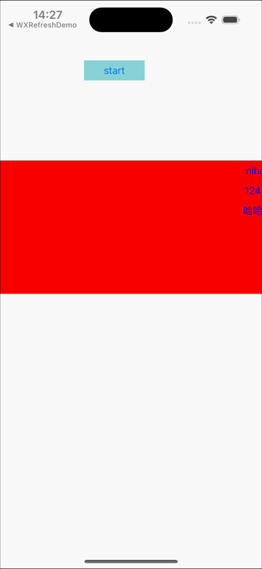

# Danmu

一个 Objective-C 写的 **iOS 弹幕组件**。



调一次 `addDanmu:` 丢一条弹幕进去，它会自己挑一条最空的行，从右往左匀速飞过屏幕，飞完自动回收复用。三个类、两百来行代码，不依赖任何弹幕商业库。

## 三个类

| 文件 | 职责 |
| --- | --- |
| `DanmuView` | 容器。管行数、择行、飞行动画、视图复用池 |
| `DanmuItem` | 数据模型。只有一个 `text` 字段 |
| `DanmuItemView` | 单条弹幕视图。负责自己的飞行动画，结束后通知容器回收 |

## 快速使用

```objc
#import "DanmuView.h"
#import "DanmuItem.h"

// 1. 建一个弹幕区（放在你想放的位置）
DanmuView *danmuView = [[DanmuView alloc] initWithFrame:CGRectMake(0, 100, self.view.bounds.size.width, 90)];
danmuView.numberOfLines = 3;      // 默认就是 3 行
[self.view addSubview:danmuView];

// 2. 往里面丢弹幕
[danmuView addDanmu:[DanmuItem itemWithText:@"前方高能"]];
[danmuView addDanmu:[DanmuItem itemWithText:@"这波操作可以"]];
```

就这两步。弹幕会自己排队、自己飞、自己回收。

## 可调参数

| 参数 | 默认值 | 说明 |
| --- | --- | --- |
| `numberOfLines` | `3` | 显示几行。改这个会重新分配内部数组，可以运行时改 |
| `DanmuItemView.height` | `30` | 单条弹幕高度，同时也是行距 |
| 飞行速度 | `80pt/s` | 写在 `moveAnim.duration` 里，改这个数就改速度 |
| 字体/颜色 | 15 号系统字 / 蓝色 | 在 `DanmuItemView` 初始化里 |
| 追尾保护间距 | `64pt` | `findProperLineWithDelay:` 里的 `offset += 64.f` |

## 它是怎么决定这条弹幕放哪一行的

每次 `addDanmu:` 都会走一遍这个流程：

1. **扫一遍现有的弹幕**，拿到每条在屏幕上的真实横坐标
2. **按行统计**，得到每行"最右边已经排到哪了"
3. **在所有行里挑最空的那行**（最右坐标最小的那行）；如果两行一样空，挑弹幕条数少的那行
4. **如果这行最后一条还没完全进屏幕**，新弹幕就往后挪一点，保证两条之间至少隔 64pt，不会追尾

代码对应 `findProperLineWithDelay:`。

### 一个容易踩的坑：为什么读 `presentationLayer`

第 1 步取坐标，用的不是 `view.frame`，而是：

```objc
CGFloat x = [[obj.layer.presentationLayer valueForKeyPath:@"position.x"] floatValue];
```

因为 `CABasicAnimation` 动的是 layer 的"表现层"，`view.frame` 在整个动画期间**始终停在终点值不动**。如果拿 frame 算，所有弹幕都会被当成"已经飞到最左边"，择行就完全失效了。

`presentationLayer` 才是屏幕上此刻真正在的位置。

## 其他几个实现细节

- **视图复用**：弹幕飞完时 `animationDidStop` 触发，容器把它塞回 `reusableItemViews` 池，不清空不销毁。下一条进来先从这个池里取，取不到才新建。长时间运行不会持续 alloc。
- **两个 malloc 数组**：`_maxPosX` 和 `_danmuCounts` 按行数在 `setNumberOfLines:` 里 `malloc`，`dealloc` 里 `free`。行数少、要频繁读，数组比字典快也省事。
- **动画结束才移除**：`removedOnCompletion = YES` 配合 `fillMode = kCAFillModeBoth`，动画一停就回到起点，所以 `animationDidStop` 里立刻 `removeFromSuperview`，不会在屏幕外堆一层看不见的视图。

## 依赖

**Masonry** —— `DanmuItemView` 用 `mas_makeConstraints` 给 label 定位。没装 Masonry 编译不过。

## 怎么集成

### 方式一：直接拖源码（推荐）

把 `Danmu/Controller/` 下 4 组文件（`DanmuView`、`DanmuItem`、`DanmuItemView`、`UIView+Extension`）拖进你的工程，装好 Masonry，就能用。

### 方式二：CocoaPods

`Danmu.podspec` 已配置好（`source_files` 指向 `Danmu/Controller/`，依赖里声明了 Masonry），直接引用即可：

```ruby
# 走远端
pod 'Danmu', :git => 'https://github.com/812602984/Danmu.git', :tag => '0.0.1'

# 或者本地路径，改代码调试时更方便
pod 'Danmu', :path => '../Danmu'
```

> **没有提交到 CocoaPods 官方源**，所以直接写 `pod 'Danmu'` 是搜不到的，必须带上 `:git` 或 `:path`。

装好后 `pod install`，Masonry 会作为依赖一起装上，不用另外处理。

## 目录说明

```
Danmu/
├── Controller/          ← 完整实现，以这里为准
│   ├── DanmuView.h/.m
│   ├── DanmuItem.h/.m
│   ├── DanmuItemView.h/.m
│   └── UIView+Extension.h/.m
├── Model/               ← 早期分层留下的副本，内容与 Controller/ 完全一致
└── View/                ← 同上
```

> `Model/` 和 `View/` 是同一批文件复制过来的，改代码请改 `Controller/` 下的，否则有两份不同步的风险。工程里实际引用的是 `Controller/`。

## 已知限制

- 弹幕只支持纯文字，没有头像、礼物、等级这些扩展位。要加得自己往 `DanmuItem` 加字段、在 `DanmuItemView` 里排版。
- 速度是全局恒定的，没有"快车道/慢车道"区分。
- `numberOfLines` 改了之后，正在飞的弹幕还停在原来的行上，只有新弹幕按新行数择行。

## License

MIT，见仓库根目录 `LICENSE`。
